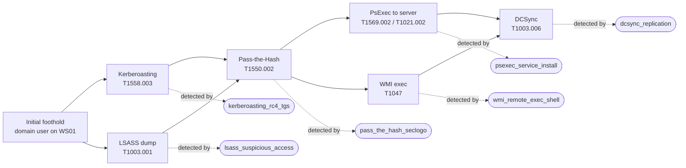

# AD Credential Theft → Lateral Movement: Detection Engineering Lab

> **What this is:** lab-based detection engineering. I ran one Active Directory attack chain in a home lab I control, wrote Sigma detections with KQL (Microsoft Sentinel) and SPL (Splunk) versions, measured true and false positives, and tuned the noisy rules.
> **Tested / not tested:** tested against my own 2-host lab (1 DC, 1 Windows 10 workstation) with Atomic Red Team and manual tooling; **not** tested in production, at enterprise scale, or against EDR-evasive variants.


## Attack chain and which rule catches each step



## Results

<!-- RESULTS:START -->
> ⚠️ **Current numbers come from synthetic seed events** written to exercise each rule's logic. Replace `tests/data/*` with exports from your lab runs (`scripts/export_lab_logs.ps1`), then re-run `python scripts/run_results.py` and paste the new table here before publishing.

| Rule | ATT&CK | TP | FN | FP before tuning | FP after tuning | What changed |
|---|---|---|---|---|---|---|
| DCSync - Directory Replication by Non-DC Account | T1003.006 | 2/2 | 0 | 2/3 | 0/3 | Excluded DC machine accounts and the Azure AD Connect (MSOL_) account |
| Kerberoasting - RC4 Service Ticket Request | T1558.003 | 2/2 | 0 | 3/4 | 0/4 | Excluded machine-account services, krbtgt and machine requesters |
| Suspicious Process Access to LSASS | T1003.001 | 3/3 | 0 | 3/4 | 0/4 | Excluded Defender, wininit, csrss and svchost source images |
| Pass-the-Hash - NewCredentials Logon via seclogo | T1550.002 | 1/1 | 0 | 1/3 | 0/3 | Allowlisted helpdesk.admin, who uses runas /netonly |
| PsExec-Style Remote Service Installation | T1569.002, T1021.002 | 3/3 | 0 | 0/2 | 0/2 | No change needed |
| Shell Spawned by WMI Provider Host | T1047 | 2/2 | 0 | 1/2 | 0/2 | Excluded SCCM client scripts (\CCM\ path) |
<!-- RESULTS:END -->

"FP before tuning" = the rule with every `filter_*` block switched off. Tuning details: [docs/tuning-log.md](docs/tuning-log.md).

## Demo (2 min)

[▶ Alert → triage → incident write-up](media/README.md) · Write-up: [docs/incident-writeup.md](docs/incident-writeup.md)

---

## Repo layout

| Path | Contents |
|---|---|
| `rules/sigma/` | Source-of-truth Sigma rules, ATT&CK-tagged |
| `rules/kql/` | Microsoft Sentinel versions |
| `rules/spl/` | Splunk versions |
| `tests/data/<rule>/` | `attack.jsonl` (must alert) and `benign.jsonl` (must not) |
| `tests/test_rules.py` | pytest regression suite, run in GitHub Actions on every push |
| `scripts/sigma_eval.py` | Small offline Sigma evaluator used by the tests |
| `scripts/run_results.py` | Builds the TP/FP table above |
| `scripts/export_lab_logs.ps1` | Exports lab Windows events to JSONL test data |
| `docs/` | Lab build, attack runbook, tuning log, incident write-up |

## Run it

```bash
pip install -r requirements.txt
pytest -v tests                 # every rule fires on attack data, stays quiet on benign data
python scripts/run_results.py   # regenerate the results table
sigma convert -t splunk --without-pipeline rules/sigma   # optional: compare with official converter
```

## Lab

See [docs/lab-setup.md](docs/lab-setup.md) and [docs/attack-runbook.md](docs/attack-runbook.md).
